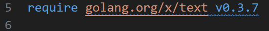
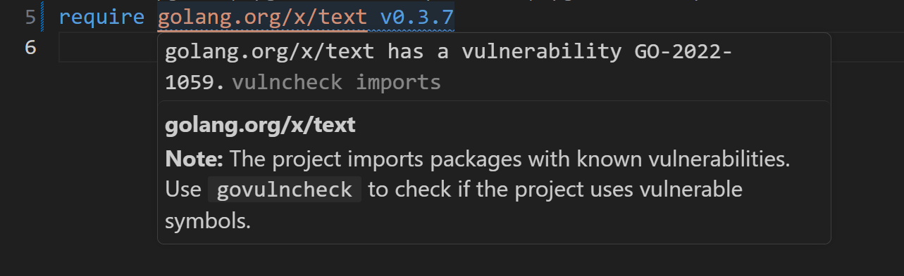
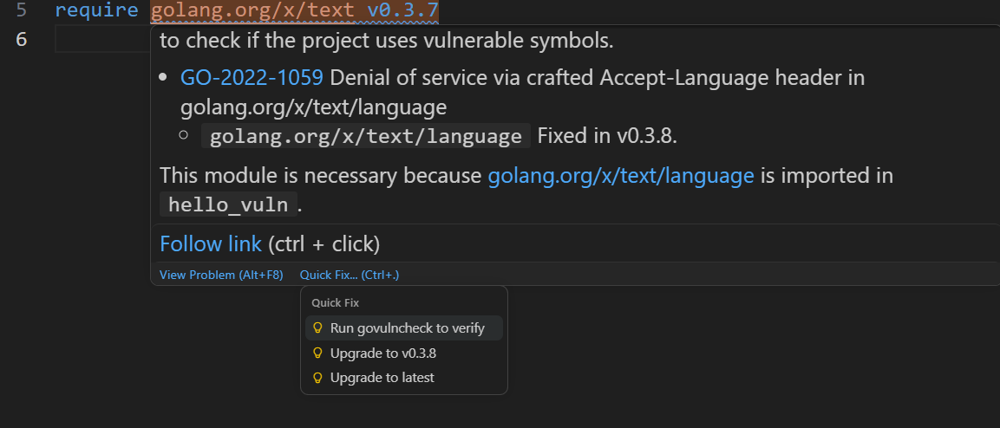

# [Tutorial: Find and fix vulnerable dependencies with VS Code Go](https://go.dev/doc/tutorial/govulncheck-ide)

## How to scan for vulnerabilities using VS Code Go

The [“Go: Toggle Vulncheck”](https://github.com/golang/vscode-go/wiki/commands#go-toggle-vulncheck) command toggles the display of vulnerability analysis in dependencies listed in the currently opened `go.mod` file.

- Open a `go.mod` file.
- Open the VS Code command palette. Search for "Go: Toggle Vulncheck".
- If any dependency has some vulnerability, then that will be decorated with a blue squiggly line under the name and version of its `require` directive. 

    

    - You can check the vulnerability details by hovering on the dependency `require` directive.

        

    - Code actions provides quick fixes:

        

- If there were no vulnerable dependencies found, there will no noticable UI changes on the IDE.

- Running the "Go: Toggle Vulncheck" command again from the command prompt hides all the added decorations.

### Settings Scope & Behavior

Under the hood, the command toggles the `go.diagnostic.vulncheck` setting between `"Imports"` and `"Off"`. Which settings file gets modified depends on whether and where the setting has already been configured:

- **By Default (Not previously configured):**
  - **Opened folder or workspace:** Updates the **current folder/workspace settings** (`.vscode/settings.json`), as `go.diagnostic.vulncheck` has resource-level scope.
  - **No folder or workspace opened:** Falls back to updating **Global (User) settings**.
- **If already configured:** The command preserves and toggles the setting at its existing configuration level following this precedence:
  1. **Workspace Folder settings** (in multi-root workspaces) if defined there.
  2. **Workspace settings** (`.vscode/settings.json` or `.code-workspace`) if defined there.
  3. **Global (User) settings** if defined there.

## Additional resources

- [Vulnerability Scanning in IDEs](https://go.dev/doc/security/vuln/editor)
- [Go Vulnerability Database](https://pkg.go.dev/vuln/)
- [Go Vulnerability Management](https://go.dev/doc/security/vuln/)