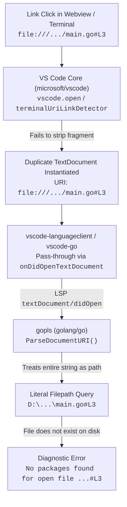

> [!CAUTION]
> **DO NOT OPEN THIS ISSUE IN `golang/vscode-go` OR `golang/go`**
>
> This is **not an issue with `vscode-go` or `golang/go`**. The Go extension simply acts as a passthrough via `vscode-languageclient`, and `gopls` cannot unilaterally strip fragments without violating Language Server Protocol (LSP) document synchronization.
>
> - **The Bug Belongs to:** **VS Code Core ([`microsoft/vscode`](https://github.com/microsoft/vscode/issues))**. When opening `file://` URIs containing `#L<line>`, VS Code fails to normalize the URI, opening a duplicate tab with a partitioned document model. This breaks language features across **all** languages (TypeScript, Python, Rust, etc.), not just Go.

---

# "No packages found" on Opening URI with Fragment (`#L<line>`)

- **Primary Component:** VS Code Core (`microsoft/vscode`) — `vscode.open` and Terminal Link Handling (`terminalUriLinkDetector`)
- **Secondary Component:** `gopls` — `golang.org/x/tools/gopls/internal/protocol/uri.go` (`ParseDocumentURI`)
- **Observed Impact:** VS Code opens duplicate tabs, and `vscode-go` / `gopls` reports `"No packages found for open file ..."`

---

## Architecture Flow



---

## Detailed Root Cause

### 1. VS Code Core (`microsoft/vscode`) — Primary Cause
- In VS Code, a `TextDocument` is keyed by its full `vscode.Uri` (including query and fragment).
- When a `file://` URI with `#L<line>` is opened (e.g. by clicking a link in the Integrated Terminal or via `vscode.open` from a webview/extension), VS Code does **not** strip the fragment.
- Consequently, VS Code instantiates a **new, duplicate `TextDocument`** whose URI literally retains `#L<line>`.
- Any edits in this tab are disconnected from the actual file model.
- **Inconsistency within VS Code:** VS Code's built-in Markdown preview (`openDocumentLink.ts`) explicitly normalizes links before opening: it strips `#L<line>` into an editor selection range (`options.selection`) and cleans the URI (`uri.with({ fragment: '' })`). Neither `terminalUriLinkDetector` nor `vscode.open` performs this normalization for `file://` URIs.

### 2. `gopls` (`golang/go`) — Secondary Cause
When `vscode-languageclient` sends `textDocument/didOpen` to `gopls` with URI `file:///.../main.go#L3`, `gopls` fails to parse RFC 3986 fragments in [`gopls/internal/protocol/uri.go`](https://cs.opensource.google/go/x/tools/+/refs/tags/v0.23.0:gopls/internal/protocol/uri.go;l=187):

```go
func ParseDocumentURI(s string) (DocumentURI, error) {
    ...
    // Naively unescapes everything after "file://" without splitting URI fragment
    path, err := url.PathUnescape(s[len("file://"):])
    if err != nil {
        return "", err
    }
    ...
    u := url.URL{Scheme: fileScheme, Path: path}
    return DocumentURI(u.String()), nil
}
```

Because `path` includes `#L3`, `u.String()` encodes it into `file:///.../main.go%23L3`. When `uri.Path()` is subsequently evaluated, it yields:
```text
D:\github\go-learn\issues\vscode-go\no-packages-found\repro\main.go#L3
```
`gopls` then queries `go list` for package metadata for this non-existent file path, resulting in:

```json
[{
	"resource": "/D:/github/.../main.go#L3",
	"owner": "_generated_diagnostic_collection_name_#3",
	"severity": 4,
	"message": "No packages found for open file D:\\github\\...\\main.go#L3.",
	"source": "go list",
	"startLineNumber": 1,
	"startColumn": 9,
	"endLineNumber": 1,
	"endColumn": 13,
	"origin": "extHost1"
}]
```

### 3. Why Neither `vscode-go` nor `gopls` Can Fix This
- **`vscode-go`:** Does not manage editor documents, tabs, or URI parsing. It relies entirely on `vscode-languageclient` and cannot prevent VS Code from creating duplicate editor tabs or partitioned document models.
- **`gopls`:** While `ParseDocumentURI` naively parses the URI, `gopls` cannot unilaterally strip `#L3` without breaking LSP document synchronization (VS Code expects all diagnostics and notifications to match the exact `DocumentUri` it opened). Furthermore, `main.go#L3` does not exist on disk, so `gopls` reporting that it cannot find packages for that path is technically accurate.

---

## Reproduction Methods

### Method 1: Webviews and Chat Links
Click any file link containing `#L<line>` from within a VS Code webview (such as AI chat panels, GitLens commit details, or PR reviews):
- [repro/main.go#L3](repro/main.go#L3)

- **Observed Behavior**: The cursor jumps to line 3, but a duplicate tab is opened with URI `.../main.go#L3` and the Problems tab reports `"No packages found for open file ..."`.

### Method 2: Integrated Terminal
1. Run the reproduction script:
   ```shell
   cd repro
   go run main.go
   ```
2. <kbd>Ctrl</kbd> + <kbd>Click</kbd> (or <kbd>Cmd</kbd> + <kbd>Click</kbd> on macOS) the printed link:
   ```text
   file:///.../main.go#L3
   ```
3. **Observed Behavior**: Opens a duplicate tab with URI `.../main.go#L3` and `gopls` reports `"No packages found"`.

---

## Where to Report

| Target Repository | Recommended Action |
| :--- | :--- |
| **[`microsoft/vscode`](https://github.com/microsoft/vscode/issues)** | File as a bug/feature request: VS Code's terminal link detector and `vscode.open` should normalize `file://` URIs with `#L<line>` into editor selection ranges (matching Markdown preview behavior) rather than creating duplicate tabs with fragment URIs. |

> [!NOTE]
> **Why not report to `golang/go` (`gopls`)?**
> Even though `gopls/internal/protocol.ParseDocumentURI` does not split URI fragments, `gopls` cannot unilaterally strip fragments without breaking LSP document synchronization with the client (VS Code expects diagnostics and events to match the exact `DocumentUri` it opened). Moreover, `main.go#L3` does not exist on disk, making `gopls`'s diagnostic technically accurate for the file path requested. The fix must be implemented on the client side in VS Code core.
