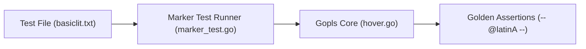
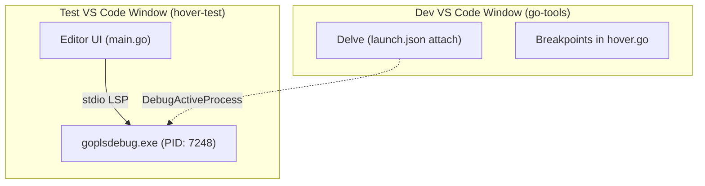
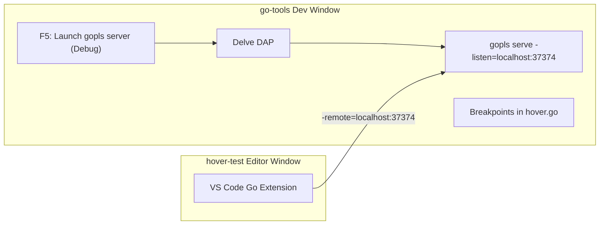
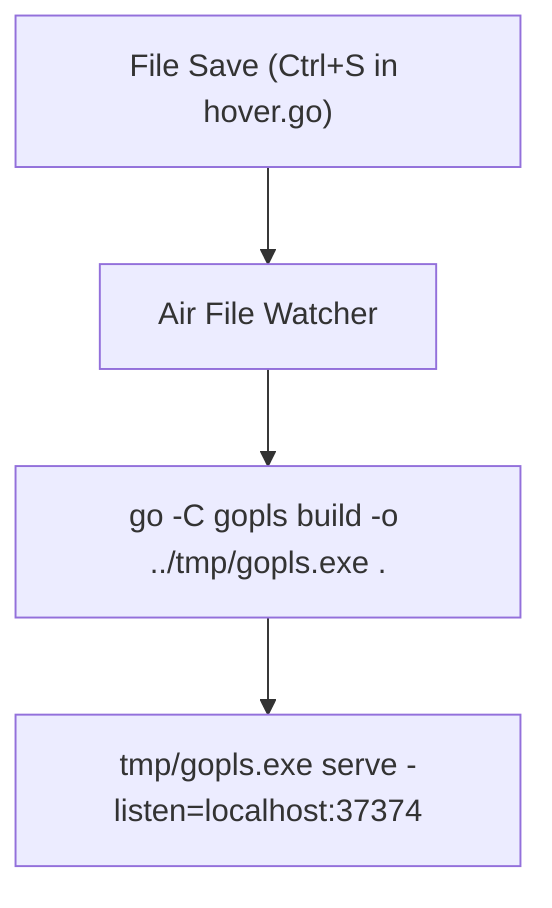
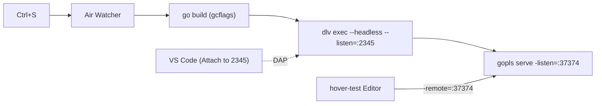

# Gopls Development & Debugging Guide

This guide details all five development and debugging workflows for contributing to `gopls` (specifically tested with [Go Issue #82225](https://github.com/golang/go/issues/82225)).

---

## Overview Comparison Matrix

| Approach | Setup Complexity | Real Editor UI? | Breakpoints? | Auto Recompile / Live Reload? | Best Used For |
| :--- | :---: | :---: | :---: | :---: | :--- |
| **1. Marker Tests** | 🟢 Low | ❌ No (Virtual) | ✅ Yes | 🟡 Manual (`go test`) | Unit testing, TDD, CI reproduction |
| **2. Attach via PID** | 🟡 Medium | ✅ Yes | ✅ Yes | ❌ Requires PID lookup each restart | Quick one-off process inspection |
| **3. Socket Daemon Mode** | 🟢 Low | ✅ Yes | ✅ Yes | 🟡 1-Key Reload (`Ctrl+Shift+F5`) | **Recommended overall workflow** |
| **4. Air (Live Reload)** | 🟡 Medium | ✅ Yes | ❌ No | ✅ Automatic on file save | Print-statement / log debugging |
| **5. Air + Delve** | 🔴 High | ✅ Yes | ✅ Yes | ✅ Auto-recompile + Re-attach | Continuous live reload + breakpoints |

---

## 1. Running & Debugging Marker Tests (Virtual / Headless)

Marker tests provide an in-memory, headless LSP simulation. They execute scenarios declared directly in `.txt` txtar files with comment annotations.



### Marker Annotation Format
In [`basiclit.txt`](https://github.com/golang/tools/blob/master/gopls/internal/test/marker/testdata/hover/basiclit.txt) (`gopls/internal/test/marker/testdata/hover/basiclit.txt`):
```go
_ = 'a' //@hover("'a'", "'a'", latinA)
```
- **Arg 1 (`src`)**: Target string pattern where hover is triggered.
- **Arg 2 (`dst`)**: Expected highlighted range in the editor.
- **Arg 3 (`golden`)**: Name of the golden block (`-- @latinA --`) defining expected markdown output.
- `_` represents "no hover expected" or "don't care".

### Execution Commands

```powershell
# Run a specific marker test
cd d:\google\go-tools\gopls\internal\test\marker
go test -run "Test/hover/basiclit" -v -count=1

# Auto-update golden files when intentionally updating outputs
go test -run "Test/hover/basiclit" -update -v
```

### Debugging with Delve or VS Code

**VS Code `.vscode/launch.json`:**
```json
{
  "name": "Debug hover/basiclit marker test",
  "type": "go",
  "request": "launch",
  "mode": "test",
  "program": "${workspaceFolder}/gopls/internal/test/marker",
  "args": ["-test.run", "Test/hover/basiclit", "-test.v"]
}
```

> [!TIP]
> **Pros**: Fastest iteration cycle; no editor interaction required; deterministic; directly runnable in CI.  
> **Cons**: Does not test client-side LSP quirks, editor rendering, or real client configurations.

---

## 2. Real Editor Hover via Attaching to Gopls Process

In this approach, a second VS Code window (e.g., `d:\temp\hover-test`) runs `gopls` directly via `stdio` using a custom-built debug binary, and the development workspace attaches Delve to that running process.



### Configuration

#### Step 1: Build debug binary
```powershell
cd d:\google\go-tools\gopls
go build -gcflags="all=-N -l" -o goplsdebug.exe .
```

#### Step 2: Configure the user test workspace (`hover-test/.vscode/settings.json`)
```json
{
  "go.alternateTools": {
    "gopls": "D:/google/go-tools/gopls/goplsdebug.exe"
  },
  "go.useLanguageServer": true
}
```

#### Step 3: Configure Dev Window (`go-tools/.vscode/launch.json`)
```json
{
  "name": "Attach to running gopls",
  "type": "go",
  "request": "attach",
  "mode": "local",
  "processId": 0 // on launching the task, you will get a prompt for entering the process id
}
```

#### Step 4: Finding the PID and enter into the Process id prompt
On Windows, check the PID via PowerShell before attaching:
```powershell
Get-Process goplsdebug | Select-Object Id, ProcessName, CommandLine
```

```text
   Id ProcessName CommandLine
   -- ----------- -----------
21292 goplsdev    D:/google/go-tools/gopls/goplsdev.exe
22596 goplsdev    D:/google/go-tools/gopls/goplsdev.exe "** telemetry **"
```
Pick the main server process, not the `** telemetry **` child process. 
You can also disable telemtry by running `go telemetry off`.


> [!WARNING]
> **Limitation**: Every time `gopls` is restarted or rebuilt, the OS assigns a new PID, requiring manual lookup and updating `processId` in `launch.json` or entering into the process id prompt.

---

## 3. Serving Gopls over TCP Socket Daemon Mode (Recommended)

`gopls` natively supports running as a standalone daemon on a TCP port using `-listen` and `-remote`. This eliminates process-ID tracking entirely and allows seamless debugging.



### Configuration

#### 1. In `go-tools/.vscode/launch.json`
```json
{
  "name": "Launch gopls server (Debug)",
  "type": "go",
  "request": "launch",
  "mode": "auto",
  "program": "${workspaceFolder}/gopls",
  "args": ["serve", "-listen=localhost:37374"]
}
```

#### 2. In `hover-test/.vscode/settings.json`
```json
{
  "go.languageServerFlags": [
    "-remote=localhost:37374"
  ]
}
```

### How to use:
1. In `go-tools`, press **F5** to start `"Launch gopls server (Debug)"`.
2. In `hover-test`, open `main.go` and hover over escape sequences.
3. Breakpoints in [`hover.go`](https://github.com/golang/tools/blob/master/gopls/internal/golang/hover.go) (`gopls/internal/golang/hover.go`) hit immediately.

### Recompiling on Code Changes:
- Press **`Ctrl + Shift + F5`** (Restart Debugger) in VS Code.
- Delve immediately stops the process, re-runs `go build`, recompiles only changed packages via `GOCACHE` (< 1 second), and restarts listening on `37374`.
- All breakpoints stay armed.

> [!TIP]
> **Why this is the standard recommendation**:
> - Zero manual PID lookup.
> - Full Delve interactive debugger (call stack, watches, step-in/step-over).
> - 1-key instant recompile.

---

## 4. Air: Live Reload for Go

[Air](https://github.com/air-verse/air) is the Go equivalent of `nodemon`. It monitors files for changes, kills the running application, recompiles the binary, and relaunches it automatically.



### Configuration (`.air.toml`)

Because `go-tools` is a multi-module repository and runs on Windows, the configuration requires:
1. `cmd = "go -C gopls build ..."` to build the nested `gopls` module.
2. `args_bin` instead of `full_bin` to prevent Air's Windows auto-extension bug (where Air appends `.exe` to the end of port arguments, e.g. `37374.exe`).
3. Excluding fixture directories (`testdata`).

```toml
root = "."
tmp_dir = "tmp"

[build]
cmd = "go -C gopls build -o ../tmp/gopls.exe ."
bin = ".\\tmp\\gopls.exe"
args_bin = ["serve", "-listen=localhost:37374"]
include_ext = ["go"]
exclude_dir = ["tmp", "vendor", "testdata", ".git", ".vscode"]
exclude_regex = [".*testdata.*"]
delay = 500
stop_on_error = true

[color]
main = "magenta"
watcher = "cyan"
build = "yellow"
runner = "green"
```

### Running:
```powershell
cd d:\google\go-tools
air
```

> [!NOTE]
> **Limitation**: Air launches `gopls` as a normal process. It is **not running under a debugger**, so VS Code breakpoints will **not** trigger. It is primarily used for rapid iteration with `fmt.Println` or log inspections.

---

## 5. Air + Delve / Live Reload + Breakpoints

To achieve both **automatic reload on file save** AND **interactive breakpoints**, two methods exist:

### Approach 5A: Air Wrapping Headless Delve

Configure Air to compile with debug flags and run `dlv` in headless mode on port `2345`.



#### 1. In `.air.toml`:
```toml
[build]
cmd = "go -C gopls build -gcflags=\"all=-N -l\" -o ../tmp/gopls.exe ."
bin = "dlv"
args_bin = [
  "exec", ".\\tmp\\gopls.exe",
  "--headless",
  "--listen=:2345",
  "--api-version=2",
  "--accept-multiclient",
  "--", "serve", "-listen=localhost:37374"
]
```

#### 2. In `.vscode/launch.json`:
```json
{
  "name": "Connect to Air Delve",
  "type": "go",
  "request": "attach",
  "mode": "remote",
  "port": 2345,
  "host": "127.0.0.1"
}
```

> [!WARNING]
> When Air kills the old binary after saving a file, the Delve socket drops, requiring you to reconnect the VS Code debugger session.

---

### Approach 5B: VS Code Auto-Restart on Save (Native & Recommended)

Instead of running Air in a terminal, configure VS Code to trigger its native debug restart whenever a `.go` file is saved.

1. Install the **[Run on Save](https://marketplace.visualstudio.com/items?itemName=emeraldwalk.RunOnSave)** extension in VS Code.
2. In VS Code User or Workspace `settings.json`:
```json
"emeraldwalk.runonsave": {
  "commands": [
    {
      "match": "\\.go$",
      "cmd": "workbench.action.debug.restart",
      "isAsync": true
    }
  ]
}
```
3. Start debugging with **Approach 3** (`"Launch gopls server (Debug)"`).

#### Workflow:
- Press **Ctrl+S** in any `.go` file.
- VS Code automatically executes `workbench.action.debug.restart`.
- Delve recompiles the modified package and restarts the server with breakpoints preserved.
- No external terminal tools, zero socket disconnect friction.
